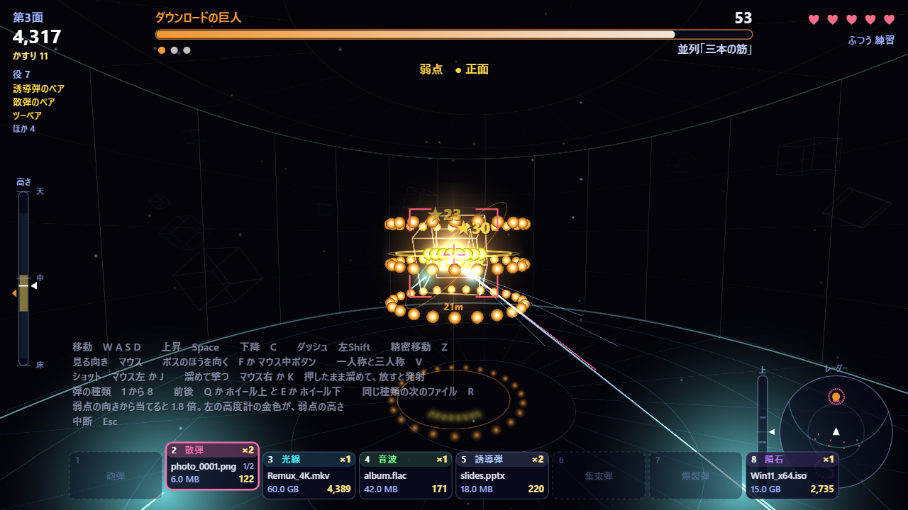
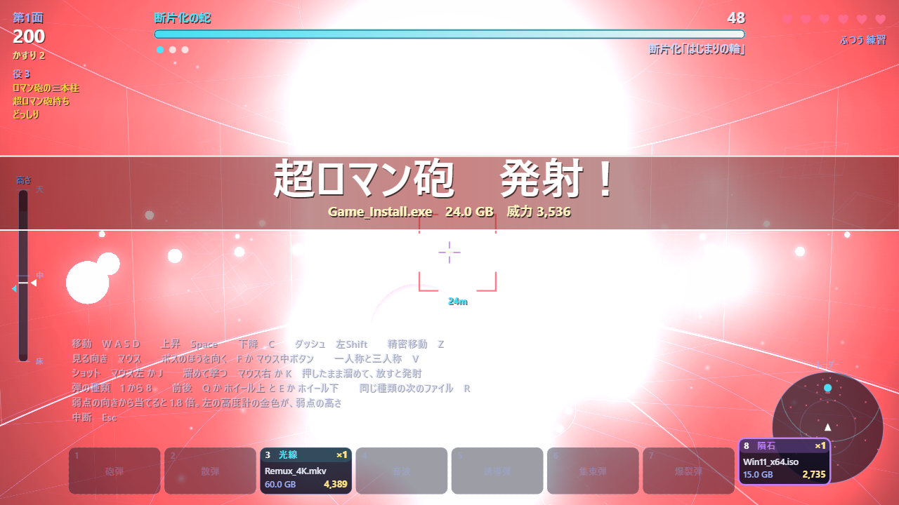
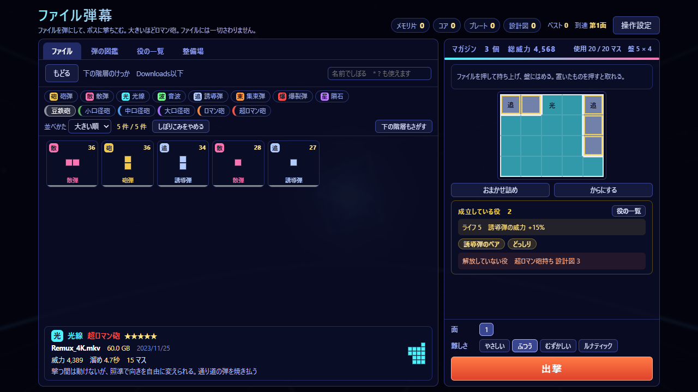
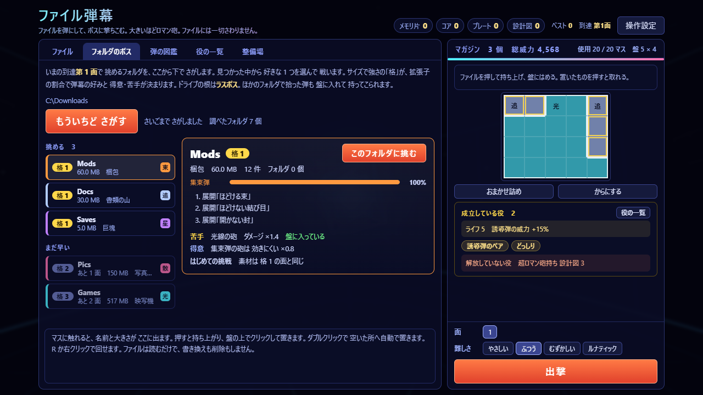

# ファイル弾幕

ファイルを弾にして、一人称の 3D 弾幕ボスに撃ちこむゲームです。大きいファイルほどロマン砲になります。

**ファイルには一切さわりません。** 読むのは名前・大きさ・更新日だけで、中身は読みません。書き換えも、移動も、削除もしません。通信もしません。

[explorer_plus](https://github.com/Neptunity-git/explorer_plus) の MOD です。`neo.file-danmaku` 2.2.1。







## 遊びかた

1. 「ファイル」の一覧から、弾にするファイルを選びます。ファイルの大きさが、弾の形と威力になります。
2. 弾を、右の容量マップ（盤）にパズルのようにはめます。重いファイルは大きな形で、少ししか持てません。軽いファイルは小さな形で、たくさん持てます。
3. 「出撃」で、一人称の 3D の戦いに入ります。マウスで見回し、ボスの弾幕をよけながら撃ちます。
4. 遊ぶと強化素材が手に入ります。マガジンの広さ・新しい役の解放・攻撃力・ライフ・速さを伸ばせます。面が進むほど、敵も強くなります。

### フォルダのボス

「フォルダのボス」の欄で「挑めるフォルダをさがす」を押すと、いま開いているフォルダから下で、挑めるフォルダが一覧に出ます。選ぶと、そのフォルダがボスになります。ドライブの根は、ラスボスです。



### そのほか

- 画面に入っていない所から来る弾は、画面のふちの印と、「▲ 上から」「▼ 下から」で知らせます。
- キーの割り当ては、「操作設定」で自分で変えられます。片手で全部の操作ができます。
- 名前・弾の種類・大きさでしぼりこめます。並べかたは 6 種類です。
- 「画面のゆれと光の点滅をへらす」設定があります。

## 入れ方

1. [Releases](https://github.com/Neo-Neptunity/file-danmaku/releases) を開き、いちばん新しい版の zip（`neo.file-danmaku-版.zip`）をダウンロードします。「Source code」ではなく、自分で付けた zip のほうです。
2. explorer_plus のホームの「MOD」の欄で「＋ MOD を入れる（zip）」を押して、zip を選びます。解凍はしません。
3. 確認の画面の「このビューが使う情報」を読んで、よければ入れます。

## 使う情報

| 使う情報 | 使いみち |
|---|---|
| `entries` | フォルダの中の、名前と種類を読む |
| `size` `modified` | 大きさと更新日を読む |
| `search` | 「挑めるフォルダをさがす」と「下の階層もさがす」で、下の階層をさがして数える |
| `pointerLock` | マウスで見回すために、ポインターを固定する |

## 設定

効果音・音楽・音量・画面のゆれと光の点滅をへらす・画質・視野の広さ・練習モード（弾に当たってもやられない）。

## 作りかた

- [docs/design.md](docs/design.md)：設計メモ
- [dev/](dev/)：自動の試験と、画面を撮る道具。説明は [dev/README.md](dev/README.md)。そこに書かれたコマンドは、作者の置き場所から流す書き方です。このリポジトリでは、先頭の `file-danmaku/` を外して読んでください。

```
node dev/unit.mjs
```

Node.js だけで動きます。`dev/browser.mjs` は Edge か Chrome が要ります。

## ライセンス

[MIT](LICENSE)
